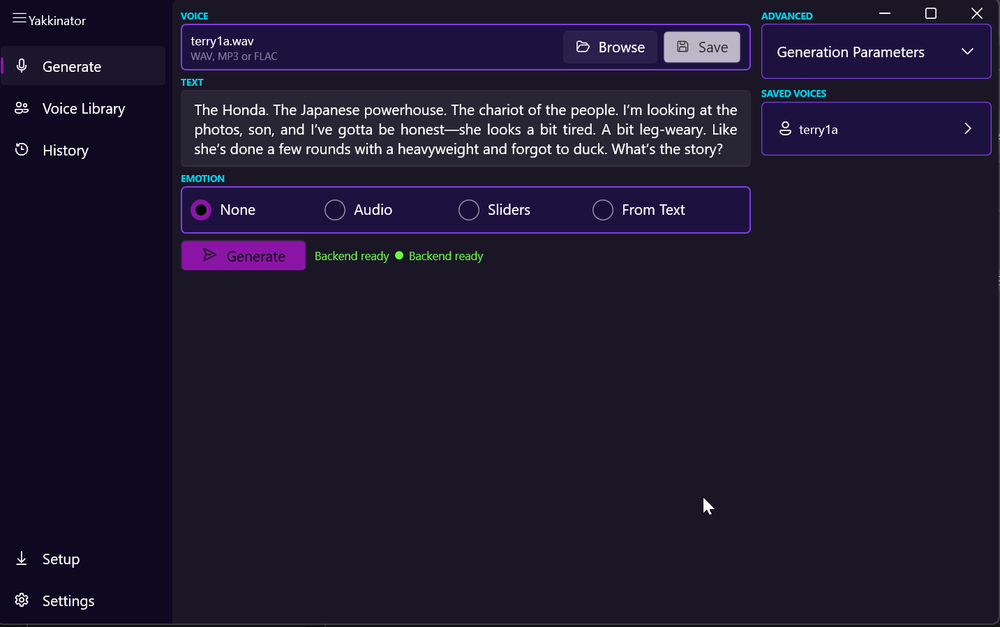

# The Yakkinator 🤖

> A retro-futuristic Text-to-Speech studio powered by IndexTTS-2. Point it at a voice sample, type your words, and let The Yakkinator do the talking.

---

## Yakkinator in Action 🎬



---

## Download 💾

**[Get TheYakkinator-v1.2.0-win-x64.zip](https://github.com/bongobongo2020/yakkinator/releases/download/v1.2.0/TheYakkinator-v1.2.0-win-x64.zip)**

---

## Quick Start ⚡

**One-click setup!** Just double-click `TheYakkinator.exe` and you're off to the races.

> **💾 Heads up:** The first run downloads ~16GB of model files to your `%LOCALAPPDATA%` folder. It's a one-time download — future launches are instant! Coffee break recommended on first run. ☕

---

## Prerequisites

### 1. Python 3.10 or later
Download from [python.org](https://www.python.org/downloads/).
During installation, check **"Add Python to PATH"**.

Verify:
```
python --version
```

### 2. CUDA Toolkit (NVIDIA GPU recommended)
IndexTTS-2 runs significantly faster on a CUDA-capable GPU.

- Download CUDA 11.8 or 12.x from [developer.nvidia.com/cuda-downloads](https://developer.nvidia.com/cuda-downloads)
- CPU-only mode works but is slow

### 3. IndexTTS Python Package
Open a terminal and run:
```
pip install indextts
```

Or for GPU support with a specific torch version:
```
pip install torch torchvision torchaudio --index-url https://download.pytorch.org/whl/cu118
pip install indextts
```

### 4. FastAPI & Uvicorn
```
pip install fastapi uvicorn
```

### 5. IndexTTS-2 Model Checkpoints
Download the model files from Hugging Face:
[IndexTeam/IndexTTS-2](https://huggingface.co/IndexTeam/IndexTTS-2)

Place the downloaded files in a folder called `checkpoints` next to the app:
```
TheYakkinator/
├── TheYakkinator.exe
├── checkpoints/
│   ├── config.yaml
│   └── ... (model files)
```

### 6. .NET 8 Runtime (if not using the self-contained build)
Download from [dotnet.microsoft.com](https://dotnet.microsoft.com/download/dotnet/8.0).

---

## Yakkinator on Android 📱

The Android app is a remote control for the Yakkinator on your PC. You type and pick a voice on the phone, the PC's GPU does the talking, and the clip plays on your phone.

**On the PC**
1. Open **Settings → Remote Access (Android app)** and switch it on. Windows may ask to let Yakkinator through the firewall; allow it.
2. Under **Address the phone uses**, pick your PC's [Tailscale](https://tailscale.com) address (`100.x.x.x`). It's listed first when Tailscale is running.

**On the phone**
1. Install `Yakkinator-android.apk` (build it from `android/`, see below) and the Tailscale app, signed into the same account as the PC.
2. In the Yakkinator app, open **Connect** and tap **Scan pairing QR code**, then scan the QR code shown in the PC's settings.

What you can do from the phone:
- Use any voice in the PC's library, pick an audio file on the phone, or record a new sample with the mic. New samples can be saved to the PC's library.
- Switch between IndexTTS-2 and Echo-TTS. The PC loads whichever engine you choose.
- Use emotion sliders, emotion-from-text and emotion-from-audio, plus the advanced sampling settings.
- Play, share and delete your generated clips. They're also saved to the PC's History.

> **🔒 Security:** The remote API uses plain HTTP, protected by an access token. Use it over Tailscale, which encrypts traffic end to end with no open ports, or over an HTTPS tunnel such as Cloudflare Tunnel (enter the tunnel's `https://` URL as the address). **Don't port-forward it directly to the internet.** If a phone is lost, click **↻** next to the token to lock it out.

**Building it yourself** (needs Android Studio, or its bundled JDK 17 plus the Android SDK):
```
cd android
gradlew assembleDebug
```
The APK is written to `android/app/build/outputs/apk/debug/app-debug.apk`. Signed release builds for Google Play are covered in [android/PLAY_STORE.md](android/PLAY_STORE.md).

---

## Choosing an Engine 🎛️

Use the **Engine** menu at the top of the Generate page to switch between:

- **IndexTTS-2** (default): voice cloning with emotion control (reference audio, sliders, or inferred from text).
- **Echo-TTS**: a fast C++ engine ([echo-tts-cpp](https://github.com/Cirius0310/echo-tts-cpp)) that clones the voice sample directly. Install it once from the **Setup** page (portable runtime ~1.7 GB + Q8 model ~5 GB, NVIDIA GPU required). Its model weights and outputs are CC-BY-NC-SA 4.0, so non-commercial use only.

Only one engine is loaded at a time, so switching frees the other's GPU memory. Echo-TTS loads on your first generation, and reloads when you use a new voice or change its parameters.

---

## Running The Yakkinator 🚀

1. **Double-click** `TheYakkinator.exe` — sit back, relax, maybe grab a snack
2. **Watch the magic** — the app auto-starts the Python backend (first run takes a few minutes)
3. **Pick a voice** — drop in any WAV/MP3 file to clone its style
4. **Type & Create** — enter your text and hit Generate. Let the yakking begin!

---

## Troubleshooting 🛠️

| Problem | Fix |
|---|---|
| `python not found` | Re-install Python and check "Add to PATH" |
| `indextts not found` | Run `pip install indextts` in terminal |
| Slow generation | Enable GPU — install CUDA and the matching torch version |
| Model not found | Ensure `checkpoints/config.yaml` exists next to the .exe |

---

**Need help?** Open an issue on GitHub and we'll get you yakking in no time! 🎙️
